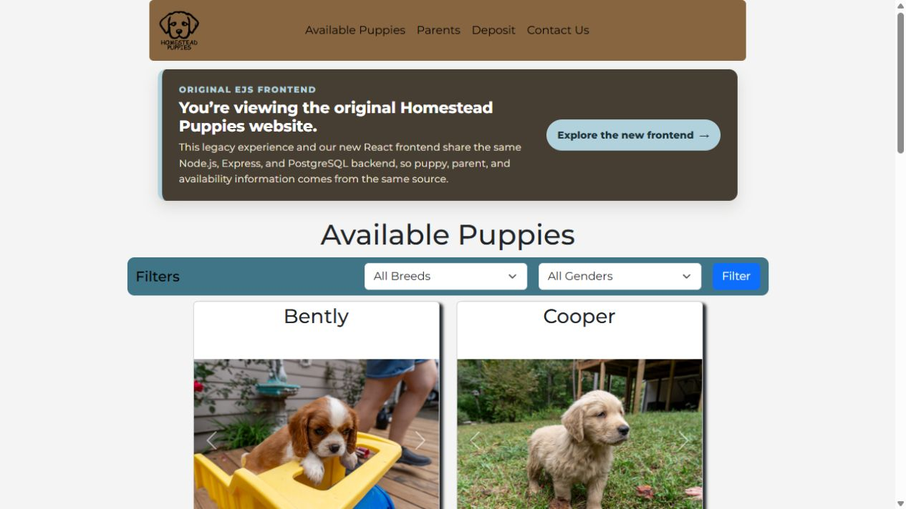
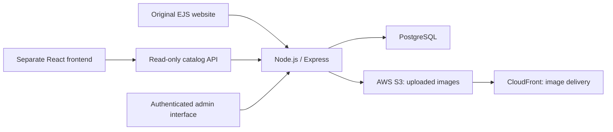

# Homestead Puppies

A full-stack application built for a family breeding business, with a public catalog and an authenticated administration interface for puppies, parents, breeds, images, and availability. What began as a static site grew into a Node.js, Express, and PostgreSQL system used by non-technical family members to manage the business.

[Original EJS site](https://homestead-puppies.com/) · [Modern React site](https://homesteadpuppies.org/) · [React source](https://github.com/apelpapa/homestead-puppies-modern)

## One backend, two frontends

This repository contains the original server-rendered EJS application, the admin tools, and the shared backend. The separate React frontend reads the same catalog through a versioned, read-only `/api/v1` API. Both public interfaces remain online.

Keeping the original admin workflow while adding the React interface demonstrates incremental modernization around an existing application and data model.

## Features

- Public puppy and parent listings with breed filters, images, and availability.
- Passport local authentication with bcrypt password checks and PostgreSQL-backed sessions.
- Admin creation, updates, and deletion for catalog records and associated images.
- Multipart image uploads, image processing with Sharp, and AWS S3 storage.
- A versioned JSON catalog API shared with the modern frontend.
- CSRF checks for state-changing routes, login/API rate limits, and Helmet response headers.
- Nginx reverse proxying and a GitHub Actions deployment workflow that restarts the app with PM2.

## Stack

| Layer | Technologies |
| --- | --- |
| Application | Node.js 24, Express, EJS |
| Data | PostgreSQL, `pg`, `connect-pg-simple` |
| Authentication | Passport Local, bcrypt, express-session |
| Media | Multer, Sharp, AWS SDK for S3, CloudFront |
| Hosting | Linux, Nginx, PM2, Cloudflare, GitHub Actions |

## Repository map

| Path | Purpose |
| --- | --- |
| `index.js` | Express routes, API responses, authentication, data access, and image handling |
| `views/` | Public EJS pages and authenticated administration templates |
| `public/` | Styles and permanent site assets |
| `ops/nginx/` | Cloudflare client-IP forwarding configuration |
| `scripts/update-image-metadata.js` | Media metadata maintenance utility |
| `.github/workflows/deploy.yml` | Deployment automation |

## License

GNU General Public License, version 3. See [LICENSE](LICENSE).
